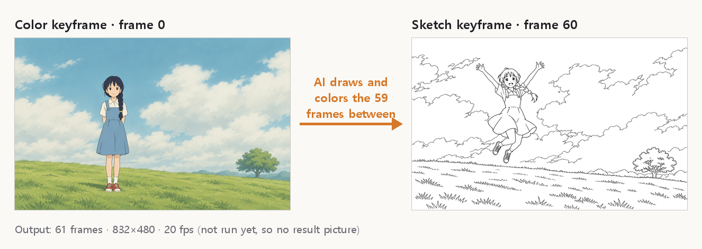

# 2D Animation Pack — Keyframes to Colored Video (ToonComposer)

[한국어](README.md)

> [!WARNING]
> This does not run on a regular PC. It needs about 57 GB of GPU memory, downloads about 82 GB, and uses more than 76 GB of RAM. There is a report that the published weights do not reproduce the official samples ([issue #19](https://github.com/TencentARC/ToonComposer/issues/19)).
>
> This plugin has not been run yet, so PromBoard shows it as "unverified". The author's PC has a 12 GB GPU, so only importing the code without the models was checked.

A PromBoard community plugin. It adds one **2D 애니메이션 · 키프레임 영상** (2D animation · keyframe video) node. Give it color keyframes, sketch keyframes and an English prompt, and it draws the frames in between and colors them in one pass. The model is Tencent ARC's [ToonComposer](https://github.com/TencentARC/ToonComposer).

## The 2D Animation Pack has three cards

| Card | What it does |
|---|---|
| [2D Animation Pack — Fill between frames](https://github.com/promboard-app/anime2d) | Inbetween two frames, make a video from two frames, raise a video's frame rate |
| [2D Animation Pack — Line art colorization](https://github.com/promboard-app/anime2d-colorize) | Color a line-art video with the colors of a character sheet |
| 2D Animation Pack — Keyframes to colored video (this card) | Inbetweening and coloring in one pass from a few keyframes |

Windows and Linux only (no macOS). "Two frames → video" and colorization need an NVIDIA GPU, and this card needs a server-class GPU. On a regular PC, use the first two cards.

## Inputs

| Port | What to connect | Required |
|---|---|---|
| 컬러 키프레임 (color keyframes) | 1–4 colored pictures, usually one picture for the first frame | Yes |
| 선화 키프레임 (sketch keyframes) | 1–4 uncolored line drawings (black lines on white). They set the pose and layout at their frames | Yes |
| 움직일 곳 (free-motion mask) | One black-and-white picture. White areas move freely instead of following the sketches. Used for every sketch keyframe | No |
| 프롬프트 (prompt) | The scene and motion in English, e.g. `A girl jumps into the air with both arms raised. Anime. High quality.` | Yes |

- With several pictures, they go to the frame numbers in the "position" settings in the order you connected them. Empty positions spread them evenly: colors from frame 0, sketches from the last frame back (the same values as the official app). If a sketch would land on a color keyframe's frame, it moves to the nearest free frame (e.g. 2 + 2 over 61 frames: colors 0 · 30, sketches 31 · 60).
- Pictures are scaled so the short side fits 832×480 (1088×608 at 608p), then center-cropped. Landscape pictures close to 16:9 lose the least.
- If something is missing, the node says what and which example card to drop in, before loading the model.

## Outputs

- Video: mp4, 20 fps, no audio. 17 · 33 · 49 · 61 frames (about 1 · 1.7 · 2.5 · 3 seconds).
- Frames: every frame of that video as a png.

## Settings

| Setting | Meaning | Default |
|---|---|---|
| 길이 (length) | 17 · 33 · 49 · 61 frames. Longer needs more memory and time | 61 frames |
| 해상도 (resolution) | 480p (832×480) · 608p (1088×608) | 480p |
| 컬러/선화 키프레임 위치 (color/sketch keyframe positions) | Frame numbers separated by commas (0 is the first frame), e.g. `0` · `30,60`. A color and a sketch cannot share a frame | Empty (spread evenly) |
| 프롬프트 따르기 (prompt guidance) | Higher follows the prompt more (CFG) | 7.5 |
| 선화 따르기 (sketch strength) | Strength of the sketch condition (official name: Pos-aware Residual Scale) | 1.0 |
| 단계 수 (steps) | More is slower | 15 |
| 시드 (seed) | -1 gives a different result each time | -1 |

The defaults match the official app, except the seed (the official app uses 42).

## Try it

The plugin includes two example cards and one workflow. The example pictures were drawn for this plugin with an image generation model (Codex CLI). One official sample picture was attached only as a drawing-style reference; the character and scene are new, not frames from any dataset or the official repository.

1. Open the workflow "컬러 키프레임 + 선화 키프레임 → 키프레임 영상".
2. From the Assets tab, drop the "예제 — 컬러 키프레임" card on the top source node and the "예제 — 선화 키프레임" card on the source node below it. Dropping a card on the plugin node does not connect it.
3. Press ▷ on the keyframe video node.

The prompt node holds an English prompt in which the standing girl jumps up with both arms raised. No result video is shown because the plugin has not been run.

## Downloads

Downloaded once, when the plugin is first prepared. PromBoard shows the size and asks first.

| Files | Size |
|---|---|
| Base model [Wan-AI/Wan2.1-I2V-14B-480P](https://huggingface.co/Wan-AI/Wan2.1-I2V-14B-480P): 7 transformer shards · T5 text encoder · CLIP image encoder · VAE · tokenizer | about 82.2 GB |
| [TencentARC/ToonComposer](https://huggingface.co/TencentARC/ToonComposer) 480p files (608p files too if you pick 608p) | 178 MB |

## Why "unverified" — known problems

- The official README asks for about 57 GB of GPU memory for 61 frames at 480p. Like the official app, this node puts the whole model on the GPU. The weights alone are about 47 GB, so on a smaller GPU the node stops before loading and says why.
- Loading is reported to use more than 76 GB of RAM (a 96 GB Windows PC, [issue #6](https://github.com/TencentARC/ToonComposer/issues/6)). So on a PC with less than 76 GB of RAM the node stops before loading and says why.
- An open report says the published code and weights do not reproduce official sample 3 ([issue #19](https://github.com/TencentARC/ToonComposer/issues/19)).
- PromBoard waits about 15 minutes for one node run (plus 3 minutes the first time, for loading). Whether a server-class GPU finishes within that was not measured.
- PromBoard installs prebuilt wheels only, so flash-attn is not installed. The node uses the PyTorch attention path that is already in the official code, which may be slower than the official numbers.

Please report problems in [issues](https://github.com/promboard-app/anime2d-tooncomposer/issues).

Without a GPU, you can try the same model on the official [Hugging Face Space demo](https://huggingface.co/spaces/TencentARC/ToonComposer). See also the official [project page](https://lg-li.github.io/project/tooncomposer) and [paper](https://arxiv.org/abs/2508.10881).

## Can I use it like this?

| What | License | Commercial use |
|---|---|---|
| ToonComposer code and weights | [MIT](https://github.com/TencentARC/ToonComposer/blob/main/LICENSE) | Allowed by the license |
| Base model Wan2.1-I2V-14B-480P | [Apache-2.0](https://huggingface.co/Wan-AI/Wan2.1-I2V-14B-480P/blob/main/LICENSE.txt) | Allowed by the license |
| This plugin's code | [MIT](LICENSE) | Allowed |

The licenses of the other two cards are in their READMEs. The colorization card has a non-commercial license, so PromBoard marks anything that went through the colorization node as "non-commercial". This table is not legal advice; check the linked originals.

## Install

1. PromBoard → Plugin Manager → **Community plugins** → Browse → install.
2. It contains code, so turn off **Restricted mode** and enable the plugin.
3. The first run downloads the Python packages and the models (about 82 GB).

The plugin texts in the app are Korean only — the plugin manifest takes a single language.

## Code (for developers)

- `nodes/tooncomposer/` is the official code ([TencentARC/ToonComposer](https://github.com/TencentARC/ToonComposer) `53dc3df`). Changes are marked `PromBoard:` and listed in [NOTICE.md](NOTICE.md).
- The official `app.py` (Gradio UI, downloads at start) is not included; its inference path is ported to `nodes/main.py`, reading the files PromBoard downloaded (the network is blocked while nodes run).
- Differences from the official app: the node takes one mask and uses it for every sketch keyframe, fitted the same way as the pictures (short side + center crop). Transparent areas of the keyframe pictures become white; transparent areas of the mask count as not moving.
- Of `diffsynth` 1.1.7's declared dependencies, the unused `controlnet-aux` and `cupy-cuda12x` are left out of the lock files ([`nodes/overrides.txt`](nodes/overrides.txt)). With that, every module imports in the same environment PromBoard builds (Python 3.12, torch 2.8.0 cu126).
- Tests: `python -m pytest tests` (input checks, positions, resizing; no models).
