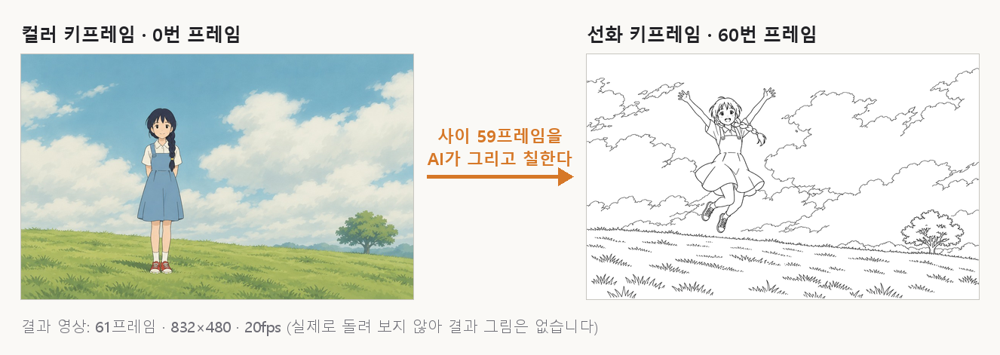

# 2D 애니메이션 팩 — 키프레임으로 채색 영상 (ToonComposer)

[English](README.en.md)

> [!WARNING]
> 일반 PC 에서는 돌지 않습니다. 그래픽카드 메모리 57GB 급, 받을 용량 약 82GB, RAM 76GB 넘게 씀. 공개된 모델 파일로는 예제가 재현되지 않는다는 보고가 있습니다([이슈 #19](https://github.com/TencentARC/ToonComposer/issues/19)).
>
> 이 플러그인은 아직 실제로 돌려 보지 않았습니다. 그래서 PromBoard 에 '검증 안 됨'으로 보입니다. 만든 쪽 PC 의 그래픽카드가 12GB 라, 모델 없이 코드를 불러오는 것까지만 확인했습니다.

PromBoard 커뮤니티 플러그인입니다. 캔버스에 **2D 애니메이션 · 키프레임 영상** 노드 하나를 더합니다. 컬러 키프레임과 선화 키프레임, 영어 프롬프트를 넣으면 그 사이 프레임을 그리고 색까지 칠한 영상을 만듭니다. 모델은 텐센트 ARC 의 [ToonComposer](https://github.com/TencentARC/ToonComposer)입니다.

## 2D 애니메이션 팩은 세 장입니다

| 카드 | 하는 일 |
|---|---|
| [2D 애니메이션 팩 — 프레임 사이 채우기](https://github.com/promboard-app/anime2d) | 두 프레임 사이 채우기, 두 프레임으로 영상 만들기, 영상 프레임 늘리기 |
| [2D 애니메이션 팩 — 선화 채색](https://github.com/promboard-app/anime2d-colorize) | 선화 영상을 캐릭터 설정화의 색으로 칠하기 |
| 2D 애니메이션 팩 — 키프레임으로 채색 영상 (이 카드) | 키프레임 몇 장으로 중간 프레임과 채색을 한 번에 |

윈도우 · 리눅스 전용입니다(맥 안 됨). '두 프레임 → 영상' · 채색은 NVIDIA 그래픽카드가 필요하고, 이 카드는 서버급 그래픽카드가 필요합니다. 일반 PC 라면 앞의 두 장을 쓰세요.

## 넣는 것

| 포트 | 넣는 것 | 꼭 넣어야 하나 |
|---|---|---|
| 컬러 키프레임 | 색을 칠한 그림 1~4장. 보통 첫 프레임 그림 한 장 | 예 |
| 선화 키프레임 | 색 없는 선 그림(흰 바탕에 검은 선) 1~4장. 그 프레임의 자세와 구도를 정합니다 | 예 |
| 움직일 곳 | 흑백 그림 한 장. 흰 곳은 선화를 따르지 않고 자유롭게 움직입니다. 모든 선화 키프레임에 같이 씁니다 | 아니요 |
| 프롬프트 | 장면과 움직임을 영어로. 예: `A girl jumps into the air with both arms raised. Anime. High quality.` | 예 |

- 여러 장을 이으면 이은 순서대로 '위치' 설정의 번호에 놓입니다. 위치를 비우면 컬러는 0번부터, 선화는 마지막 프레임 쪽부터 고르게 나눕니다(공식 앱과 같은 값). 이때 선화가 컬러와 같은 프레임에 오면 가장 가까운 빈 프레임으로 옮깁니다(예: 61프레임에 2장씩이면 컬러 0 · 30, 선화 31 · 60).
- 그림은 짧은 변을 832×480(608p 는 1088×608)에 맞춰 늘린 뒤 가운데를 자릅니다. 가로 16:9 에 가까운 그림이 덜 잘립니다.
- 빠진 것이 있으면 모델을 불러오기 전에 무엇이 빠졌는지, 어떤 예제 카드를 놓으면 되는지 알려 줍니다.

## 나오는 것

- 영상: mp4, 20fps, 소리 없음. 17 · 33 · 49 · 61프레임(약 1 · 1.7 · 2.5 · 3초).
- 프레임: 그 영상의 프레임을 한 장씩 png 로.

## 설정

| 설정 | 뜻 | 처음 값 |
|---|---|---|
| 길이 | 17 · 33 · 49 · 61프레임. 길수록 메모리와 시간이 더 듭니다 | 61프레임 |
| 해상도 | 480p(832×480) · 608p(1088×608) | 480p |
| 컬러 키프레임 위치 · 선화 키프레임 위치 | 둘 프레임 번호를 쉼표로(0 이 첫 프레임). 예: `0` · `30,60`. 컬러와 선화를 같은 번호에 둘 수 없습니다 | 비움(고르게 나눔) |
| 프롬프트 따르기 | 클수록 프롬프트를 더 따릅니다(CFG) | 7.5 |
| 선화 따르기 | 선화 키프레임 조건을 넣는 세기(공식 이름 Pos-aware Residual Scale) | 1.0 |
| 단계 수 | 많을수록 느립니다 | 15 |
| 시드 | -1 이면 매번 다른 결과 | -1 |

처음 값은 공식 앱과 같습니다. 시드만 다르고, 공식 앱은 42 입니다.

## 해 보기

플러그인에 예제 카드 2장과 워크플로우 1개가 들어 있습니다. 예제 그림은 이 플러그인을 위해 AI(Codex CLI 그림 생성)로 새로 그렸습니다. 공식 저장소 예제 그림 한 장을 그림체 참고로만 붙였고, 캐릭터와 장면은 새로 만들었습니다(데이터셋이나 공식 저장소의 그림이 아닙니다).

1. 워크플로우 「컬러 키프레임 + 선화 키프레임 → 키프레임 영상」을 엽니다.
2. 에셋 탭의 '예제 — 컬러 키프레임' 카드를 맨 위 소스 노드에, '예제 — 선화 키프레임' 카드를 그 아래 소스 노드에 끌어 놓습니다. 플러그인 노드 위에 놓으면 선이 이어지지 않습니다.
3. 키프레임 영상 노드의 ▷ 를 누릅니다.

프롬프트 노드에는 '서 있던 소녀가 두 팔을 들고 뛰어오른다'는 영어 글이 들어 있습니다. 실제로 돌려 보지 않아 결과 영상은 싣지 않았습니다.

## 받는 것과 용량

처음 실행 준비 때 한 번 받습니다. PromBoard 가 크기를 보여 주고 확인을 받습니다.

| 파일 | 크기 |
|---|---|
| 바탕 모델 [Wan-AI/Wan2.1-I2V-14B-480P](https://huggingface.co/Wan-AI/Wan2.1-I2V-14B-480P): 변환기 7조각 · T5 글 인코더 · CLIP 그림 인코더 · VAE · 토크나이저 | 약 82.2GB |
| [TencentARC/ToonComposer](https://huggingface.co/TencentARC/ToonComposer) 480p 파일(608p 를 고르면 608p 파일을 더 받음) | 178MB |

## '검증 안 됨'인 까닭과 알려진 문제

- 공식 안내로 480p 61프레임에 그래픽카드 메모리가 약 57GB 필요합니다. 이 노드는 공식 앱처럼 모델 전체를 그래픽카드에 올립니다. 모델 무게만 약 47GB 라서, 그보다 작은 그래픽카드에서는 모델을 불러오기 전에 멈추고 까닭을 알립니다.
- 모델을 불러오는 동안 RAM 을 76GB 넘게 쓴다는 보고가 있습니다(RAM 96GB 윈도우 PC, [이슈 #6](https://github.com/TencentARC/ToonComposer/issues/6)). 그래서 이 PC 의 RAM 이 76GB 보다 작으면 모델을 불러오기 전에 멈추고 까닭을 알립니다.
- 공개된 코드와 가중치로 공식 예제 3번이 재현되지 않는다는 보고가 열려 있습니다([이슈 #19](https://github.com/TencentARC/ToonComposer/issues/19)).
- PromBoard 는 노드 한 번을 약 15분까지 기다립니다(처음 한 번은 모델을 불러올 3분을 더 기다림). 서버급 그래픽카드에서 이 안에 끝나는지 재 보지 않았습니다.
- PromBoard 는 미리 만들어진 패키지만 깔아서 flash-attn 이 없습니다. 공식 코드에 있는 PyTorch 기본 어텐션으로 돌아 공식 안내보다 느릴 수 있습니다.

문제가 있으면 [이슈](https://github.com/promboard-app/anime2d-tooncomposer/issues)로 알려 주세요.

그래픽카드가 없다면 공식 [Hugging Face Space 데모](https://huggingface.co/spaces/TencentARC/ToonComposer)에서 같은 모델을 웹으로 써 볼 수 있습니다. 공식 [프로젝트 페이지](https://lg-li.github.io/project/tooncomposer) · [논문](https://arxiv.org/abs/2508.10881)도 있습니다.

## 이렇게 써도 되나요

| 무엇 | 라이선스 | 상업 이용 |
|---|---|---|
| ToonComposer 코드 · 가중치 | [MIT](https://github.com/TencentARC/ToonComposer/blob/main/LICENSE) | 라이선스상 가능 |
| 바탕 모델 Wan2.1-I2V-14B-480P | [Apache-2.0](https://huggingface.co/Wan-AI/Wan2.1-I2V-14B-480P/blob/main/LICENSE.txt) | 라이선스상 가능 |
| 이 플러그인 코드 | [MIT](LICENSE) | 가능 |

다른 두 장의 라이선스는 각 카드 README 에 있습니다. 채색 카드는 비상업 라이선스라서, 채색 노드를 한 번이라도 거친 결과물에는 PromBoard 가 '비상업' 표시를 붙입니다. 이 표는 법률 조언이 아니니 링크한 원문을 확인하세요.

## 설치

1. PromBoard → 플러그인 매니저 → **커뮤니티 플러그인** → 둘러보기에서 설치합니다.
2. 코드가 든 플러그인이라 **제한 모드**를 끄고 플러그인을 켭니다.
3. 처음 실행할 때 파이썬 패키지와 모델(약 82GB)을 받습니다.

## 코드 (개발자용)

- `nodes/tooncomposer/` 는 공식 코드([TencentARC/ToonComposer](https://github.com/TencentARC/ToonComposer) `53dc3df`)를 옮긴 것입니다. 고친 곳은 `PromBoard:` 주석으로 표시했고 목록은 [NOTICE.md](NOTICE.md)에 있습니다.
- 공식 `app.py`(Gradio 화면 · 시작할 때 모델 받기)는 담지 않고, 그 추론 경로를 `nodes/main.py` 에 옮겼습니다. 모델은 PromBoard 가 받아 둔 파일에서 읽습니다(실행 중에는 인터넷이 막힙니다).
- 공식 앱과 다른 점: 마스크는 노드에 한 장만 받아 모든 선화 키프레임에 쓰고, 그림과 같은 방법(짧은 변 맞춤 + 가운데 자르기)으로 크기를 맞춥니다. 키프레임 그림의 투명한 곳은 흰 바탕으로 채우고, 마스크의 투명한 곳은 움직이지 않는 곳으로 봅니다.
- `diffsynth` 1.1.7 이 적은 의존성 중 쓰지 않는 `controlnet-aux` · `cupy-cuda12x` 는 잠금 파일에서 뺐습니다([`nodes/overrides.txt`](nodes/overrides.txt)). 이 상태로 PromBoard 와 같은 가상환경(Python 3.12 · torch 2.8.0 cu126)에서 모든 모듈이 불러와지는 것을 확인했습니다.
- 시험: `python -m pytest tests` (입력 검사 · 위치 · 크기 맞추기, 모델 없이).
